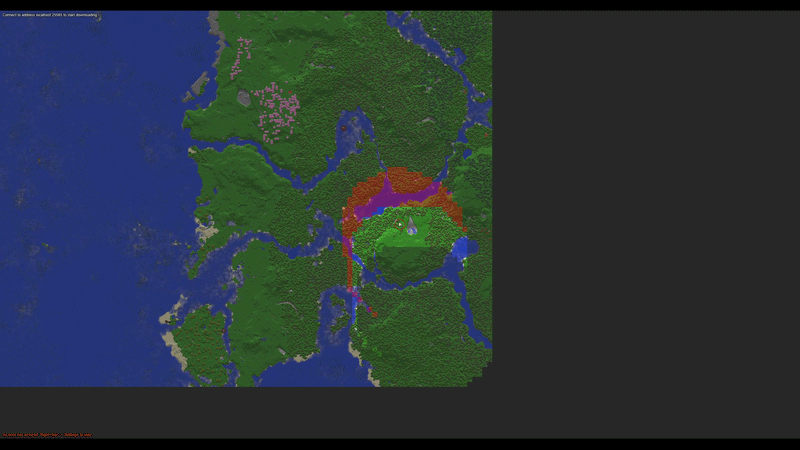
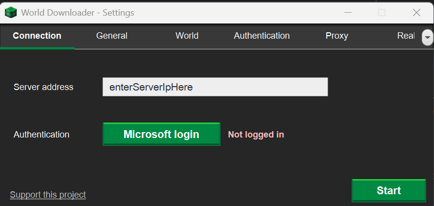
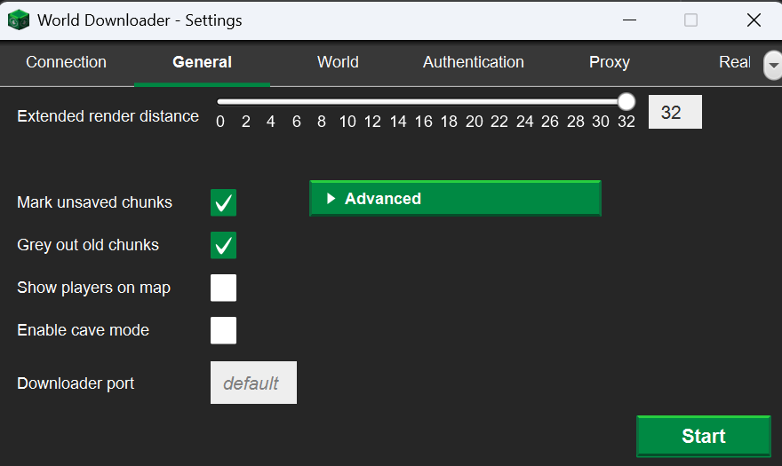
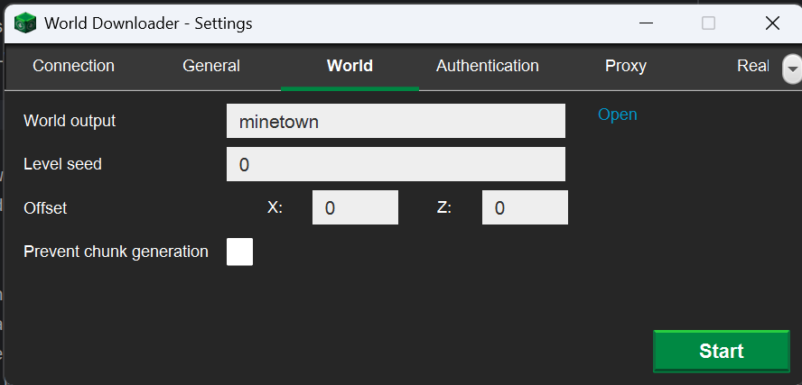
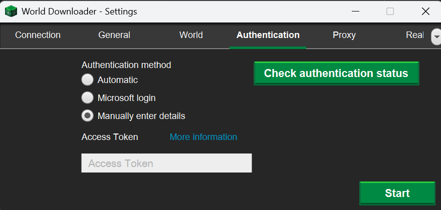
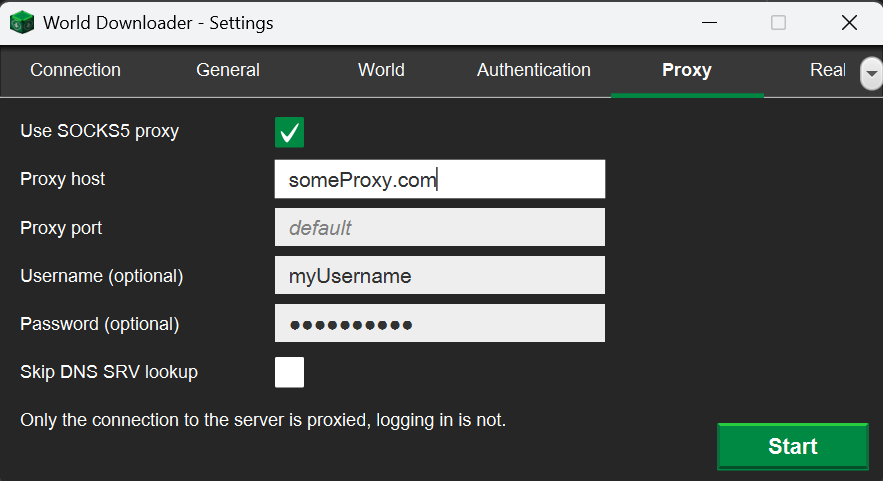

# Minecraft World Downloader



A fork of [mircokroon/minecraft-world-downloader](https://github.com/mircokroon/minecraft-world-downloader) - 
A Minecraft world downloader that works as a proxy server between the client and the server to read & save chunk 
data as you explore it. Download multiplayer worlds by connecting to them and walking around. Perfect for
historical archival of servers, preserving your hundred-hour builds, or just for fun. This fork adds quality of
life enhancements from the upstream repo that has since been abandoned.

**NOTE:** Every chunk you want to download has to be in your render distance as you explore them. This, 
nor any other tool, can download chunks that are not sent to your client by the server.

> [!WARNING]
> This tool is intended for personal and research purposes only. Downloading worlds from servers without permission 
> may violate the server's rules or terms of service. Always check with the server owner before using this tool on their server.

## Features
- Real-time chunks downloading as you explore the world.
- Real-time progress display with rendered chunk preview. You can see where you've explored, where you are now, and where you still need to visit.
- SOCKS5 proxy support between the downloader client and the multiplayer server. This allows you to use a VPN to safely explore servers without revealing your IP address.

## How it Works
1. You run the Minecraft World Downloader (this repo) on your computer, which starts a local proxy server.
2. You configure the downloader to point to the multiplayer server you want to download from, providing your Minecraft authentication details.
3. You configure your Minecraft client to connect to the local proxy server instead of the multiplayer server.
4. The downloader intercepts the data sent between your Minecraft client and the multiplayer server, saving the chunk data to your local disk as you explore the world.
5. The multiplayer server sees your Minecraft client as a normal player, so you can explore the world and download it without any special permissions.

## Supported Versions
The following multiplayer server versions are supported by this tool. Servers older than 1.12.2, all the way back
to Classic, can be downloaded by running [ViaProxy](https://github.com/ViaVersion/ViaProxy) alongside the
downloader. See [Legacy Servers](#legacy-servers) for how to set it up.

If a newer version you are trying to download is not listed, you may be able to run
[ViaFabricPlus](https://github.com/ViaVersion/ViaFabricPlus) in your client to downgrade the protocol version to one
that is supported. This relies on server-side support for older versions, typically from servers running
[ViaBackwards](https://github.com/ViaVersion/ViaBackwards).

| Minecraft version       |                    Protocol | Data version |
|-------------------------|----------------------------:|-------------:|
| 26.3                    |                         777 |         5023 |
| 26.2                    |                         776 |         4903 |
| 26.1, 26.1.1, 26.1.2    |                         775 |         4790 |
| 1.21.11                 |                         774 |         4671 |
| 1.21.9, 1.21.10         |                         773 |         4556 |
| 1.21.7, 1.21.8          |                         772 |         4440 |
| 1.21.6                  |                         771 |         4435 |
| 1.21.5                  |                         770 |         4325 |
| 1.21.4                  |                         769 |         4189 |
| 1.21.2, 1.21.3          |                         768 |         4080 |
| 1.21, 1.21.1            |                         767 |         3953 |
| 1.20.5, 1.20.6          |                         766 |         3839 |
| 1.20.3, 1.20.4          |                         765 |         3700 |
| 1.20.2                  |                         764 |         3578 |
| 1.20, 1.20.1            |                         763 |         3463 |
| 1.19.4                  |                         762 |         3337 |
| 1.19.3                  |                         761 |         3218 |
| 1.19 - 1.19.2           |                         759 |         3105 |
| 1.18 - 1.18.2           |                         757 |         2860 |
| 1.17, 1.17.1            |                         755 |         2724 |
| 1.16.2 - 1.16.5         |                         701 |         2578 |
| 1.15.2                  |                         550 |         2200 |
| 1.14.1 - 1.14.4         |                         440 |         1901 |
| 1.13.2                  |                         341 |         1444 |
| 1.12.2                  |                         317 |         1132 |
| 1.0 - 1.12.1            | [ViaProxy](#legacy-servers) |         1132 |
| Beta b1.0 - b1.8.1      | [ViaProxy](#legacy-servers) |         1132 |
| Alpha a1.0.15 - a1.2.6  | [ViaProxy](#legacy-servers) |         1132 |
| Classic c0.0.15 - c0.30 | [ViaProxy](#legacy-servers) |         1132 |

Versions reached through ViaProxy are saved as a 1.12.2 world (data version 1132) when you connect with the
recommended 1.12.2 client.

## Legacy Servers
Servers older than 1.12.2 speak a protocol the downloader doesn't understand, so you run a translator between the
two. **[ViaProxy](https://github.com/ViaVersion/ViaProxy)** is a standalone proxy that lets a modern client join
almost any server version, from Classic through the latest release. The pre-1.8 translation comes from
**[ViaLegacy](https://github.com/ViaVersion/ViaLegacy)**, which ViaProxy has built in.

The downloader sits between your client and ViaProxy:

```
Minecraft client (1.12.2) -> World Downloader -> ViaProxy -> Legacy server (e.g. b1.7.3)
```

The downloader reads the protocol version from your client when it connects. It only ever sees 1.12.2, so it saves
the world exactly like it would from a 1.12.2 server. ViaProxy handles everything older.

### Setup
1. Download the latest `ViaProxy-x.y.z.jar` from the [ViaProxy releases](https://github.com/ViaVersion/ViaProxy/releases/latest) page and run it.
2. Set the server address to the legacy server and pick its version, such as `b1.7-b1.7.3`.
3. If the legacy server is online mode, add your Minecraft account in ViaProxy's Accounts tab. ViaProxy logs in to the server for you, so the downloader doesn't have to.
4. Click Start. ViaProxy listens on `localhost:25568` by default.
5. Point the downloader's server address at `localhost:25568` and start it.
6. Connect your 1.12.2 Minecraft client to the downloader on `localhost` and start exploring.

### Things to Know
- **Use a 1.12.2 client.** It's the closest version to the legacy servers, so ViaProxy has the fewest translation steps to make. Newer clients work too. They just stack more translation on top.
- **Legacy support is best effort.** Every block, sign, and chest passes through ViaProxy before the downloader sees it. If ViaProxy translates something wrong, it gets saved wrong.
- **Beta servers never send biomes.** ViaLegacy rebuilds them from the world seed, so they should match the original generator but aren't read from the server.
- **The output is a 1.12.2 world.** Modern versions of Minecraft upgrade it when you open it. It can't be opened in the original legacy version.

## Menus
Target server the proxy should connect to and download chunks from:


For servers that support it, asking for extended render distance chunks increases the amount of chunks around you being 
requested and downloaded on your behalf, regardless of your client settings.


Output:


The proxy connects directly to the remote Minecraft server and must have your Minecraft account access:


Optionally, the proxy can connect to the remote Minecraft server through a SOCKS5 proxy.

